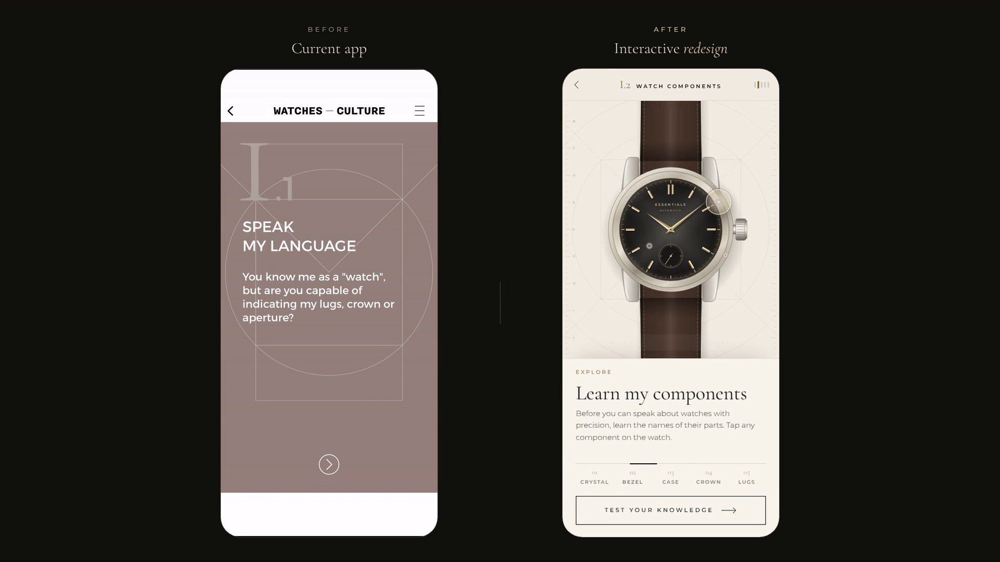

# Watch Essentials: interactive redesign prototype

This is a working, mobile-first prototype of the next generation of the FHH Academy **Watch Essentials** learning experience (chapter *I · Speak my language*, step *I.2 · Watch components*). It was built for a short before/after comparison with the current app.

It has no dependencies and no backend. It runs offline: vanilla JavaScript, an SVG watch and the Web Animations API, with the fonts bundled locally.



## Launch

Choose one of these:

```bash
# A. Single file, no server needed: double-click it or open it in any browser
open dist/watch-essentials.html

# B. Serve the source folder (Node 18+, no npm install)
node tools/serve.mjs          # → http://localhost:4173/
```

To view the phone layout on a laptop, open the page in a desktop browser. It appears inside a device frame. You can also use the browser's device toolbar (e.g. 390 × 844).

## Demo modes

| URL / key | What it does |
|---|---|
| `/` | Normal experience. It starts at the introduction, and every reload resets it. |
| `?autoplay` | A scripted ~10 s run for screen recording. It drives the **real** UI with a visible touch indicator. |
| `?autoplay=full` | The whole chapter (~28 s), including a wrong answer, all three questions and completion. |
| `?scene=explore` / `?scene=quiz` | Jump straight to the watch or to the knowledge check. |
| <kbd>A</kbd> / <kbd>R</kbd> | Start autoplay / reset (desktop). |

## Recording the 10-second demonstration

Record in portrait at 390 × 844, either on a phone or in the browser's device mode. For a hands-free take, open `?autoplay`. To record it by hand, follow these steps:

| Time | Action | What the viewer sees |
|---|---|---|
| 0.0 s | Load the page | The construction drawing draws itself, a seconds hand sweeps and locks at twelve, and the headline rises line by line. |
| ~1.9 s | Tap **Begin learning** | The construction circle opens like an aperture onto the technical plate, and the watch is *drawn as a blueprint, then rendered*. The hands then sweep to the time. |
| ~3.8 s | Tap the **bezel** (the polished ring) | The rest of the watch fades back, the bezel is traced in brass and a technical call-out draws in (`02 BEZEL · lunette`). The definition updates. |
| ~5.2 s | Tap the **crown** | The camera moves to the crown. The crown pulls out, turns, and the hands advance 30 minutes, then it pushes back home. |
| ~7.0 s | Tap **Test your knowledge** | The watch glides up and enlarges, and the bezel breathes as the highlighted part. The question appears with BEZEL / CRYSTAL / CASE. |
| ~8.4 s | Tap **Bezel** | The answer fills in ink, a check draws and a chime ring leaves the case. The explanation and "Bezel added to your watch" appear. |

For a version that also shows feedback on a wrong answer, tap **Crystal** first. You get a gentle strike-through and a hint, then you can try again.

## Pre-rendered previews (`preview/`)

| File | Contents |
|---|---|
| `after-10s-demo.mp4` | 780 × 1688 (2×), 30 fps, 11.6 s, recorded from `?autoplay` |
| `after-10s-demo.gif` | The same demo at 360 px wide, for decks and email |
| `after-full-chapter.mp4` | The full chapter run, 28.6 s |
| `before-after.mp4` | 1920 × 1080 side by side. The original app's reference screens are on the left and the demo is on the right. |
| `390x844-*.png` and others | QA screenshots of every state at 375 × 812, 390 × 844, 430 × 932 and desktop |

The "before" side uses the supplied screenshots of the current app as a slideshow. For the real comparison, put your own screen recording of the current app next to `after-10s-demo.mp4`.

## What is interactive

- **Explore.** Tap any part of the watch: crystal, bezel, case, crown or lugs. The component rail below the watch gives the same choices. Each part has its own demonstration:
  - crystal: a light glint across the glass
  - bezel: a trace around the ring
  - case: the hidden movement drawn as a dashed hidden-line
  - crown: it pulls out, turns and sets the hands
  - lugs: the spring bars appear as hidden lines

  Tapping the same part again replays its demonstration.
- **Knowledge check.** There are three questions (bezel, crown, lugs). Wrong answers get specific, non-punitive hints and you can try again. Correct answers animate the part itself and explain it.
- **Completion.** You see a score, the components you earned (echoing the original "earn watch components" mechanic), *Explore again* and *Retake*.
- **Back** works from every scene. Hit areas are keyboard-focusable, and haptics fire on Android.

## Motion system

- One custom house curve, the *escape* curve `cubic-bezier(.16,1,.3,1)`: a fast release that settles precisely. It is paired with a symmetric *balance* curve for travel and a small *detent* overshoot for things that "lock" (hands, markers).
- A choreographed intro: SVG stroke drawing (`pathLength` + dash offset), staggered masked text reveals, letter-spacing tightening, and a hand that sweeps one turn and then beats at 1 Hz.
- An **aperture transition**: `clip-path: circle()` grows from the intro's construction circle.
- A **blueprint → render** build: hairline outlines draw, the materials fade in, and the hands sweep with a detent.
- A **camera**: the SVG `viewBox` is tweened per component, which gives a real zoom and pan without rasterising. It is refitted every frame to the stage's aspect ratio. Moving between explore and quiz animates the stage height (FLIP), so the watch is a persistent shared element.
- A **focus veil**: an SVG mask fades everything except the selected part, and the part is traced in brass.
- Technical **call-outs** with a halo leader line that draws, an anchor that pops with a detent, and a label that settles from wide tracking.
- A live movement. The hands keep real time from 10:08, the small seconds ticks at 8 beats/s (28,800 vph), and the crown demonstration actually changes the time.
- `prefers-reduced-motion` collapses every duration and removes looping pulses. The flow still works, and QA checks it.

## Horological accuracy

The watch is drawn at about 6 SVG units per mm:

- a 40.7 mm case with 20 mm lug width (the strap tapers to 18 mm) and about 47 mm lug-to-lug
- a fixed polished bezel around the crystal
- the crown and case tube at 3 o'clock
- small seconds at 6, so there is no 6 o'clock index
- dauphine hands

On tap targets:

- **Crystal:** tapping the dial area selects the crystal, because the crystal is the surface you actually touch.
- **Lugs:** they count as lugs only where they leave the case. The "Case" highlight includes the lugs, because they are part of it. The quiz hint for *Case* says exactly that.

The definitions are concise and deliberately hedged where practice varies ("on many watches", "depending on the movement", "usually by means of spring bars"). Each part also carries its French term (glace, lunette, boîte, couronne, cornes). The dial is unbranded.

## Files

```
watch-essentials/
  index.html          markup for the three scenes
  styles.css          design tokens, layout, fonts (@font-face → fonts/)
  motion.js           easing curves, WAAPI helper, cancellable rAF tween
  content.js          components, definitions, quiz and hints (edit copy here)
  watch.js            SVG watch, hit areas, veil, highlights, call-outs, camera
  app.js              scenes, state, transitions, autoplay demo
  fonts/              Cormorant Garamond + Montserrat (SIL OFL, licences included)
  reference/before/   screenshots of the current app
  dist/               single-file build
  preview/            videos, GIF, screenshots
  tools/serve.mjs     zero-dependency static server
  tools/build-standalone.mjs  → dist/watch-essentials.html
  tools/qa.mjs        end-to-end checks (Playwright)
  tools/record.mjs    autoplay → MP4 + GIF (Playwright + ffmpeg)
  tools/compare.mjs   before/after film (Playwright + ffmpeg)
```

The tools in `tools/` other than `serve.mjs` need Playwright with Chromium (`npm i -D playwright`) and, for video, `ffmpeg`. The prototype itself needs neither.

```bash
node tools/qa.mjs                  # 110 checks across 4 viewports + reduced motion + autoplay
node tools/record.mjs              # preview/after-10s-demo.{mp4,gif}
node tools/record.mjs full         # preview/after-full-chapter.mp4
node tools/compare.mjs             # preview/before-after.mp4
node tools/build-standalone.mjs    # dist/watch-essentials.html
```

## Limitations

- It is a prototype of one step (I.2) and does not cover the whole Watch Essentials app. The menu, FAQ, video lesson and progress persistence are out of scope.
- The watch is a high-quality vector illustration, not a photograph or 3D model.
- It was tested in Chromium (headless), at mobile sizes and on desktop. It uses standard web APIs (WAAPI, CSS `clip-path`, container units) that current Safari and Firefox support, but it has not been checked on physical iOS or Android devices.
